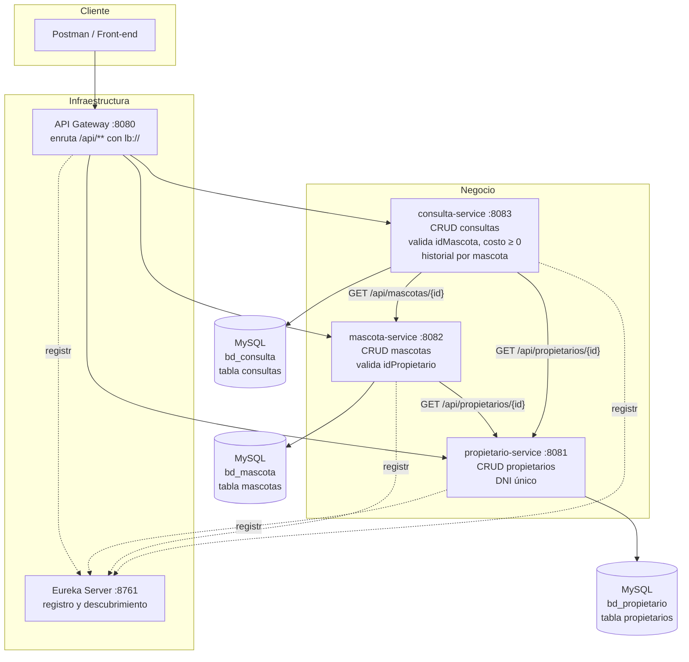
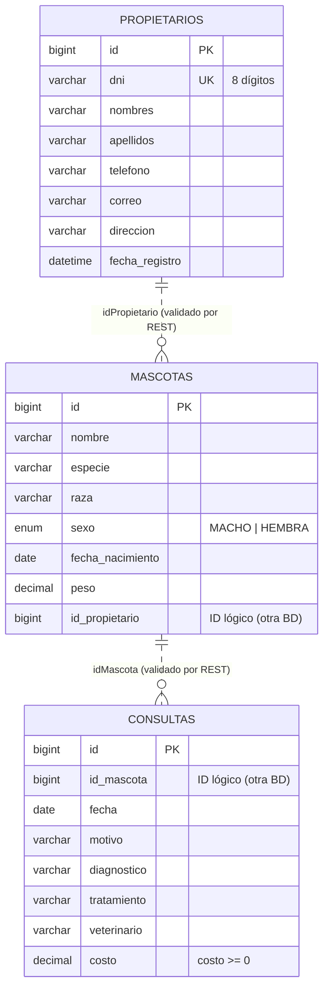
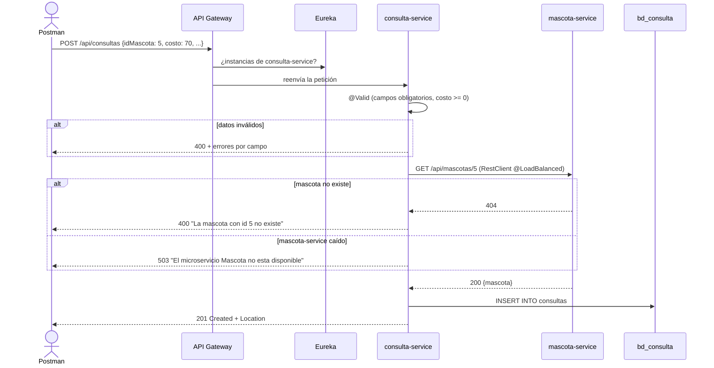

# Diagramas – Sistema de Atención Veterinaria

## 1. Microservicios, responsabilidades y bases de datos

## 2. Modelo de datos (una base por microservicio)

Las líneas punteadas indican que **no hay clave foránea física**: cada tabla está en una base de datos
distinta y la integridad se valida llamando al otro microservicio.

## 3. Secuencia: registrar una consulta

