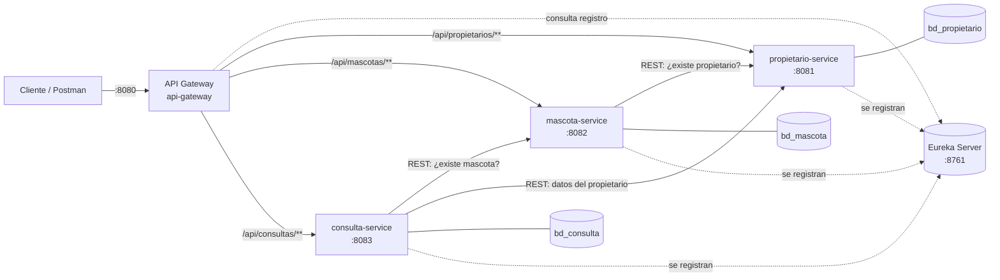

# Sistema de Atención Veterinaria – Microservicios con Spring Boot

**Evaluación N.° 03 – Desarrollo de Aplicaciones Web Avanzado: Microservicios (Tecsup)**
**Estudiante:** Jeanfranco Anderson Flores Valencia
**Módulo asignado:** Atención veterinaria → microservicios **Propietario**, **Mascota** y **Consulta**

Una veterinaria necesita administrar propietarios, mascotas y consultas. El sistema está dividido en
tres microservicios de negocio independientes. Cada uno tiene su propia base de datos MySQL y su
propio puerto. Se registran en **Eureka Server** y se accede a ellos a través de un **API Gateway**.

---

## 1. Requisitos

| Herramienta | Versión |
|---|---|
| Java (JDK) | 17 o superior |
| Maven | 3.9+ (o el de IntelliJ/STS) |
| MySQL | 8.x (también funciona MariaDB 10.x / XAMPP) |
| Postman | cualquiera reciente |

Tecnologías: Spring Boot 3.5.7, Spring Cloud 2025.0.0 (Netflix Eureka, Gateway, LoadBalancer),
Spring Web, Spring Data JPA / Hibernate, Bean Validation, MySQL Driver, H2 (perfil test), Lombok y DevTools.

## 2. Arquitectura



| Microservicio | Puerto | Base de datos | Responsabilidad |
|---|---|---|---|
| `eureka-server` | 8761 | – | Registro y descubrimiento de servicios |
| `api-gateway` | 8080 | – | Punto de entrada único; enruta con `lb://` (balanceo vía Eureka) |
| `propietario-service` | 8081 | `bd_propietario` | CRUD de propietarios (DNI único) |
| `mascota-service` | 8082 | `bd_mascota` | CRUD de mascotas; valida `idPropietario` contra propietario-service |
| `consulta-service` | 8083 | `bd_consulta` | CRUD de consultas; valida `idMascota` contra mascota-service; historial y costo |

Las bases de datos no comparten tablas ni claves foráneas. Las referencias entre servicios son
**solo IDs** (`idPropietario`, `idMascota`) y se validan **por REST** (`RestClient` + `@LoadBalanced`
con el nombre lógico registrado en Eureka, p. ej. `http://propietario-service`).

En [`docs/diagrama.md`](docs/diagrama.md) están el diagrama de clases y el de bases de datos.

### Estructura de cada microservicio

```
src/main/java/pe/edu/tecsup/veterinaria/<servicio>/
├── model/        Entidades JPA (@Entity)
├── dto/          Request (con validaciones) y Response (records)
├── repository/   Interfaces JpaRepository + consultas derivadas
├── services/     Interfaz + implementación con la lógica de negocio
├── controller/   @RestController (endpoints REST)
├── exception/    Excepciones propias + @RestControllerAdvice (GlobalExceptionHandler)
├── client/       Clientes REST hacia otros microservicios (mascota y consulta)
└── config/       Bean RestClient.Builder @LoadBalanced (mascota y consulta)
src/main/resources/
├── application.yml   Configuración común + perfiles dev / test / prod
├── data-mysql.sql    Datos de prueba (perfil dev)
└── data-h2.sql       Datos de prueba (perfil test)
```

## 3. Configuración YAML y perfiles

Cada `application.yml` contiene un bloque común y tres perfiles separados por `---`. El perfil por defecto
es **dev**.

| Valor | `dev` | `test` | `prod` |
|---|---|---|---|
| Base de datos | MySQL local (`localhost:3306`), crea la BD si no existe | H2 en memoria (no necesita MySQL) | MySQL indicado por `DB_HOST` / `DB_PORT` |
| Usuario / clave | `DB_USERNAME` (por defecto `root`) / `DB_PASSWORD` (por defecto vacía) | `sa` / vacía | **Obligatorio** por variables de entorno `DB_USERNAME`, `DB_PASSWORD` |
| `ddl-auto` | `update` | `create-drop` | `validate` (las tablas se crean con el script SQL) |
| Datos de prueba | Sí (`data-mysql.sql`) | Sí (`data-h2.sql`) | No (`sql.init.mode: never`) |
| `show-sql` | `true` (formateado) | `false` | `false` |
| Eureka | Activo | Desactivado | Activo (`EUREKA_URL`) |
| SSL de MySQL | `useSSL=false` | – | `useSSL=true` |
| Logs | `DEBUG` para `pe.edu.tecsup` | por defecto | `WARN` (root) / `INFO` |
| Actuator expuesto | `health, info` | `health, info` | solo `health` |

En Eureka, el perfil **dev** desactiva la autopreservación para limpiar rápido las instancias caídas; en
**prod** se mantiene activa. En el Gateway, **dev** registra las rutas con `DEBUG`.

> No se suben credenciales reales al repositorio: todas se leen de variables de entorno.

Cambiar de perfil:

```bash
# Maven
mvn spring-boot:run -Dspring-boot.run.profiles=test
# JAR
java -jar target/mascota-service-1.0.0.jar --spring.profiles.active=prod
# Variable de entorno (Windows PowerShell)
$env:SPRING_PROFILES_ACTIVE="prod"; $env:DB_HOST="servidor"; $env:DB_USERNAME="usuario"; $env:DB_PASSWORD="****"
```

## 4. Bases de datos

- **Perfil dev:** no hay que crear nada. Al iniciar cada servicio se crea su BD
  (`createDatabaseIfNotExist=true`), Hibernate crea la tabla y se cargan los datos de prueba
  (`INSERT IGNORE`, así que no se duplican al reiniciar).
- **Perfil prod (o para revisar el modelo):** ejecutar [`database/script_bd_veterinaria.sql`](database/script_bd_veterinaria.sql).
  Crea las 3 bases, las tablas y los datos de prueba.

Datos de prueba cargados:

| BD | Registros |
|---|---|
| `bd_propietario` | 3 propietarios (id 1 a 3) |
| `bd_mascota` | 4 mascotas (Firulais y Michi → propietario 1, Rocky → 2, Pelusa → 3) |
| `bd_consulta` | 4 consultas (2 de Firulais, 1 de Michi, 1 de Rocky) |

Si la clave de tu MySQL no está vacía, antes de iniciar los servicios define `DB_PASSWORD`
(o cámbiala en el perfil dev del `application.yml`).

## 5. Ejecución

**Orden de arranque:** 1) Eureka → 2) los 3 microservicios → 3) API Gateway.

```bash
# Compilar todo (desde la raíz) y ejecutar las pruebas automáticas
mvn clean package

# En terminales separadas (o con Run en IntelliJ en el mismo orden)
cd eureka-server       && mvn spring-boot:run
cd propietario-service && mvn spring-boot:run
cd mascota-service     && mvn spring-boot:run
cd consulta-service    && mvn spring-boot:run
cd api-gateway         && mvn spring-boot:run
```

Verificación:

- Panel de Eureka: <http://localhost:8761> (deben aparecer API-GATEWAY, PROPIETARIO-SERVICE, MASCOTA-SERVICE y CONSULTA-SERVICE).
- Rutas del Gateway: <http://localhost:8080/actuator/gateway/routes>
- Prueba rápida: <http://localhost:8080/api/mascotas>

## 6. Endpoints (a través del Gateway: `http://localhost:8080`)

### Propietario – `/api/propietarios`
| Método | Ruta | Descripción | Respuestas |
|---|---|---|---|
| GET | `/api/propietarios` | Listar (opcional `?nombre=texto`) | 200 |
| GET | `/api/propietarios/{id}` | Buscar por ID | 200, 404 |
| GET | `/api/propietarios/dni/{dni}` | Buscar por DNI | 200, 404 |
| POST | `/api/propietarios` | Registrar | 201, 400, 409 (DNI duplicado) |
| PUT | `/api/propietarios/{id}` | Actualizar | 200, 400, 404, 409 |
| DELETE | `/api/propietarios/{id}` | Eliminar | 204, 404 |

```json
{ "dni": "76543210", "nombres": "Jeanfranco Anderson", "apellidos": "Flores Valencia",
  "telefono": "987111222", "correo": "jflores@correo.com", "direccion": "Av. Cayma 456, Arequipa" }
```

### Mascota – `/api/mascotas`
| Método | Ruta | Descripción | Respuestas |
|---|---|---|---|
| GET | `/api/mascotas` | Listar (opcional `?especie=Perro`) | 200 |
| GET | `/api/mascotas/{id}` | Buscar por ID | 200, 404 |
| GET | `/api/mascotas/{id}/detalle` | Mascota + datos del propietario (REST) | 200, 404, 503 |
| GET | `/api/mascotas/propietario/{idPropietario}` | Mascotas de un propietario | 200 |
| POST | `/api/mascotas` | Registrar (valida que exista el propietario) | 201, 400, 503 |
| PUT | `/api/mascotas/{id}` | Actualizar | 200, 400, 404, 503 |
| DELETE | `/api/mascotas/{id}` | Eliminar | 204, 404 |

```json
{ "nombre": "Toby", "especie": "Perro", "raza": "Beagle", "sexo": "MACHO",
  "fechaNacimiento": "2023-03-15", "peso": 12.5, "idPropietario": 1 }
```

### Consulta – `/api/consultas`
| Método | Ruta | Descripción | Respuestas |
|---|---|---|---|
| GET | `/api/consultas` | Listar (opcional `?desde=2026-10-01&hasta=2026-11-30`) | 200, 400 |
| GET | `/api/consultas/{id}` | Buscar por ID | 200, 404 |
| GET | `/api/consultas/{id}/detalle` | Consulta + mascota + propietario (REST) | 200, 404, 503 |
| GET | `/api/consultas/mascota/{idMascota}` | Historial clínico y costo total de una mascota | 200 |
| POST | `/api/consultas` | Registrar (valida que exista la mascota) | 201, 400, 503 |
| PUT | `/api/consultas/{id}` | Actualizar | 200, 400, 404, 503 |
| DELETE | `/api/consultas/{id}` | Eliminar | 204, 404 |

```json
{ "idMascota": 1, "fecha": "2026-11-06", "motivo": "Vacunación antirrábica",
  "diagnostico": "Paciente sano, apto para vacuna", "tratamiento": "Vacuna antirrábica",
  "veterinario": "Dra. Ana López", "costo": 70.00 }
```

## 7. Validaciones y manejo de errores

| Campo | Regla |
|---|---|
| Propietario `dni` | obligatorio, 8 dígitos, único (409 si se repite) |
| Propietario `nombres`, `apellidos`, `telefono` | obligatorios; teléfono de 7 a 15 dígitos; `correo` con formato válido |
| Mascota `nombre`, `especie`, `fechaNacimiento`, `idPropietario` | obligatorios; fecha no futura; `peso` > 0; el propietario debe existir |
| Consulta `idMascota`, `fecha`, `motivo`, `diagnostico`, `costo` | obligatorios; **costo no negativo**; la mascota debe existir |

Todas las respuestas de error tienen el mismo formato (`GlobalExceptionHandler`):

```json
{
  "timestamp": "2026-11-06T17:29:59.61",
  "status": 400,
  "error": "Bad Request",
  "mensaje": "Los datos enviados no son validos",
  "path": "/api/consultas",
  "errores": { "motivo": "El motivo es obligatorio", "costo": "El costo no puede ser negativo" }
}
```

| Situación | Código HTTP |
|---|---|
| Datos inválidos, JSON mal formado, fecha con formato incorrecto o ID no numérico | 400 |
| Referencia inexistente en otro servicio (propietario o mascota) | 400 |
| ID inexistente o ruta inexistente | 404 |
| DNI duplicado | 409 |
| Otro microservicio caído o no registrado en Eureka | 503 |
| Error no controlado | 500 (mensaje genérico, el detalle va al log) |

## 8. Pruebas

- **Automáticas:** `mvn clean package` ejecuta 16 pruebas con MockMvc (perfil `test`, H2). Los clientes
  REST se simulan con `@MockitoBean`. Cubren el CRUD completo, 400, 404, 409 y 503.
- **Postman:** importar [`postman/Veterinaria-Microservicios.postman_collection.json`](postman/Veterinaria-Microservicios.postman_collection.json).
  Tiene 35 peticiones con *tests*: casos exitosos y casos de error (datos inválidos, ID inexistente,
  referencias inexistentes, costo negativo…). Se puede ejecutar completa con el **Collection Runner**:
  los IDs creados se guardan en variables de colección.

**Prueba de aceptación:** registrar propietario → registrar mascota de ese propietario → registrar
consulta de esa mascota → ver `/api/consultas/{id}/detalle` → actualizar y eliminar cada uno.

## 9. Documentación adicional

- [`docs/diagrama.md`](docs/diagrama.md): diagramas de microservicios, bases de datos y secuencia.
- [`docs/conclusiones.md`](docs/conclusiones.md): conclusiones, dificultad con su solución y guía para la sustentación.
